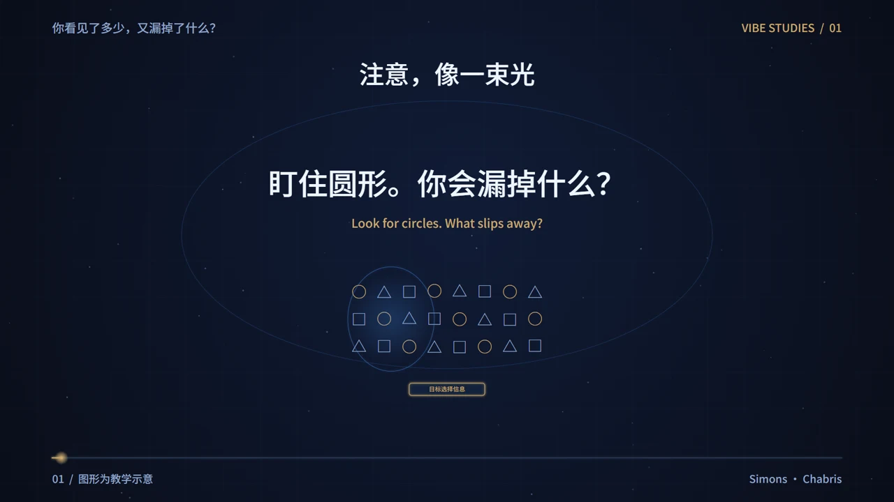

# 心间漫游 · 心理学可视化博物馆 3.0

**看见自己，读懂彼此。**

通过原创少年漫画、双语 Vibe 短片与教学互动探索心理学。阅读设计面向小学高年级、初中生及好奇的成人。

[在线预览](https://yangwei251003.github.io/xinjian-manyou/) · [源码与版本记录](https://github.com/yangwei251003/xinjian-manyou)


## 这一版

- 8 个展区、28 个完整主题、168 张独立漫画图。
- 每课一支 75.8 秒短片，1920×1080、60 fps，双语字幕与原创 76 BPM 器乐。
- 28 套主题机制图，包括注意光束、记忆重建、归因路径、框架比例、提取时间线与测量工具类比。
- 每课含预测、解释、误读澄清、迁移题与生活任务。另有14个教学演示，分布在13课中。
- 18 个学科入口、8 个生活场景、17 份研究档案、11 本书和10组人物导览。进化心理学保留待扩展入口。
- 新增知识诅咒、确认偏误、心理测量信效度、感恩记录四课。
- 搜索正文、漫画对白、科学术语和中文学科。收藏、展区、场景和搜索可组合。
- 手机课页保留关联研究。视频有同步双语阅读条、全屏、文字稿和播放失败重试。
- 无需登录。书签与阅读记录保存在当前浏览器，可清空。



## 在电脑上打开

准备 Node.js 22 或更新版本，双击 `START_WINDOWS.bat`，或执行下面的命令。

```sh
npm start
```

打开终端显示的本机地址。阅读和播放使用包内资源。网站运行无需制作工具或密钥。也可使用 `python -m http.server 4173`，完整的视频拖动验证使用本项目 Node 服务。

## 可编辑 OpenFilm 工程

本机工程位于 `~/Documents/VideoCreation/Projects/xinjian-manyou-v3/<课程ID>/`。每课有六个原生主画面片段、独立音乐轨及与场景 Link 的动作音效。标题、字幕和布局保留 DOM，可以在工作台选取修改。

`production/` 保存全部制作源码、28支双语脚本、24格新漫画提示词及修订记录。制作环境需要 Python、NumPy、SciPy、Pillow、fontTools、Brotli、FFmpeg、Playwright和Chrome。

```sh
python production/build.py
python production/score.py
node production/render.mjs --playwright <Playwright入口路径> --workers 2
python production/verify.py
```

重建前检查修改指纹。手动调整过的页面和时间线会保留，并提示通过 OpenFilm 继续导出。独立HTML内嵌字体与动画代码，暴露 `render(t)` 和 `window.film.frame(t)`。直接打开可预览画面，音乐位于原生时间线。

仓库包含现有脚本所需字体子集，可直接复用。新增字符时取得Noto Sans SC完整字体及许可，用`python production/build.py --font-source <字体目录>`指定含`NotoSansSC.ttf`和`LICENSE.txt`的目录。分镜脚本包含场景时间码、具体画面、切换小节和逐句双语字幕。

PNG原件、无损音轨及原生导出抽检保存在本机制作工程。公共仓库保留运行所需WebP、全部28支MP4、字体许可和可复现代码。参考原片与完整转写留在私人研究目录。

## 验证

```sh
npm run sync
npm run check
npm test
npm run validate
```

发布检查核对课程清单、六格独立漫画、图片唯一性、逐课视频、字幕覆盖、资料关联和素材路径。

实际浏览器回归连接正在运行的网站。

```sh
node tests/browser-v3.mjs --base http://127.0.0.1:4173/ --playwright <Playwright入口路径>
```

验证范围见 [3.0验收记录](docs/QA-v3.md)。工程检查、媒体解码与主观视听评审分别记录。视频完整连续看听的证据尚未齐备，主观总分保留为空。专业内容审读、真实儿童学习效果、实体手机和完整读屏测试仍待完成。

## 科学内容与许可

课程区分具体研究结论、条件和证据边界。教学演示采用简化材料。心理测量和健康评估需要合适的专业人员、工具与多种信息。

代码MIT。原创文案、美术与配乐在可授权范围内CC BY 4.0。Noto Sans SC使用OFL-1.1。第三方资料保留各自权利。详见 [素材与资料说明](docs/CREDITS-v3.md) 和 [内容许可](CONTENT-LICENSE.md)。

## 更新

- 3.0 · 2026-11-05。逐课短片、四门新课、科学来源补强、搜索与窄屏入口修复、可编辑工作台。
- 2.0 · 2026-11-01。24课、144格独立漫画、书籍人物与教学互动。
