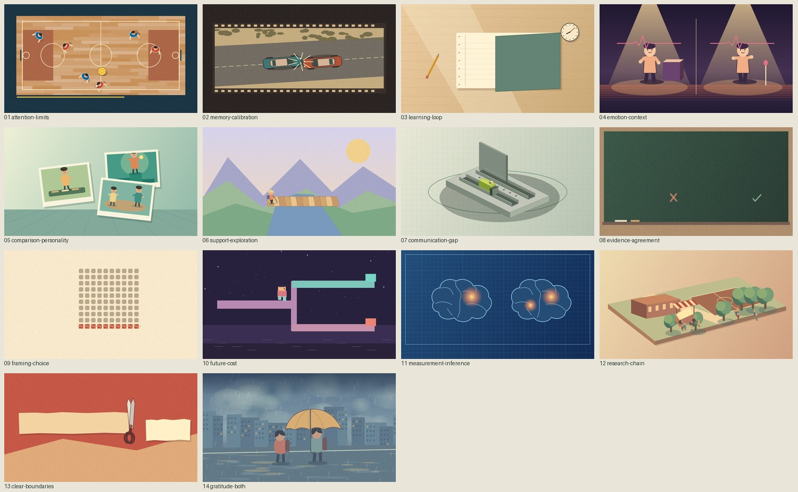

# 心间漫游 · 心理学可视化博物馆 3.3

**看见自己，读懂彼此。**

通过原创少年漫画、动画短片与教学互动探索心理学。阅读设计面向小学高年级、初中生及好奇的成人。

[在线预览](https://yangwei251003.github.io/xinjian-manyou/) · [心理学短片集](https://yangwei251003.github.io/xinjian-manyou/films.html) · [源码与版本记录](https://github.com/yangwei251003/xinjian-manyou)


## 2026-11-06 原创动画版

14 支短片分别设计场景、动作和声音，覆盖 28 个知识点。球场用传球计数展示注意选择，工坊用旋转装置展示视角差，街机用不可退的代币区分过去成本与未来选择。电影内有中文字幕，网站同步显示中英字幕和出处。



可复现源码、原始研究出处、配乐制作和验证记录见[原创动画工程](production/director-cuts/README.md)。

## 这一版

- 8 个展区、28 个完整主题、168 张独立漫画图。
- 14 支短片覆盖 28 课，50 至 69 秒，1920×1080、30 fps，双语阅读与原创声音。
- 28 套主题机制图，包括注意光束、记忆重建、归因路径、框架比例、提取时间线与测量工具类比。
- 每课含预测、解释、误读澄清、迁移题与生活任务。另有14个教学演示，分布在13课中。
- 18 个学科入口、8 个生活场景、17 份研究档案、11 本书和10组人物导览。进化心理学保留待扩展入口。
- 新增知识诅咒、确认偏误、心理测量信效度、感恩记录四课。
- 搜索正文、漫画对白、科学术语和中文学科。收藏、展区、场景和搜索可组合。
- 手机课页保留关联研究。视频有同步双语阅读条、全屏、文字稿和播放失败重试。
- 无需登录。书签与阅读记录保存在当前浏览器，可清空。


## 漫画册页布局

漫画现在整册展开：桌面三列两行，手机两列连续阅读。每格约为原大图宽度的四分之一，保留完整画面；轻点可放大，使用按钮或方向键查看相邻格，按 Esc 回到原位置。

预测问题和故事提示在桌面陪伴册页，手机上顺序接续。首页、故事列表、书架和相关推荐使用更小的完整预览；短片、机制说明和关联资料配合新的阅读宽度。


[手机册页实拍](docs/previews/comic-album-mobile.png) · [布局和交互验收](docs/QA-comic-gallery.md)

## 在电脑上打开

准备 Node.js 22 或更新版本，双击 `START_WINDOWS.bat`，或执行下面的命令。

```sh
npm start
```

打开终端显示的本机地址。阅读和播放使用包内资源。网站运行无需制作工具或密钥。也可使用 `python -m http.server 4173`，完整的视频拖动验证使用本项目 Node 服务。

## 历史制作源码

原 production 根目录、recut 与 narrative 保存旧版源码、脚本和检查记录。当前影片的制作入口是 [production/director-cuts](production/director-cuts/README.md)。

公共运行资源保留原许可与归属；参考原片、完整转写和未获公开分发许可的附件均不上传。

## 验证

```sh
npm run sync
npm run check
npm test
npm run validate
```

发布检查核对课程清单、六格独立漫画、图片唯一性、逐课视频、字幕覆盖、资料关联和素材路径。

实际浏览器回归连接正在运行的网站。

```sh
node tests/browser-v3.mjs --base http://127.0.0.1:4173/ --playwright <Playwright入口路径>
```

验证范围见 [3.0验收记录](docs/QA-v3.md)。工程检查、媒体解码与主观视听评审分别记录。视频完整连续看听的证据尚未齐备，主观总分保留为空。专业内容审读、真实儿童学习效果、实体手机和完整读屏测试仍待完成。

## 科学内容与许可

课程区分具体研究结论、条件和证据边界。教学演示采用简化材料。心理测量和健康评估需要合适的专业人员、工具与多种信息。

代码MIT。原创文案、美术与配乐在可授权范围内CC BY 4.0。Noto Sans SC使用OFL-1.1。第三方资料保留各自权利。详见 [素材与资料说明](docs/CREDITS-v3.md) 和 [内容许可](CONTENT-LICENSE.md)。

## 更新

- 漫画册页布局 · 2026-11-05。全站漫画预览缩小、整册连续展开、导览与短片排版联动、放大连续阅读。
- 3.0 · 2026-11-05。逐课短片、四门新课、科学来源补强、搜索与窄屏入口修复、可编辑工作台。
- 2.0 · 2026-11-01。24课、144格独立漫画、书籍人物与教学互动。
